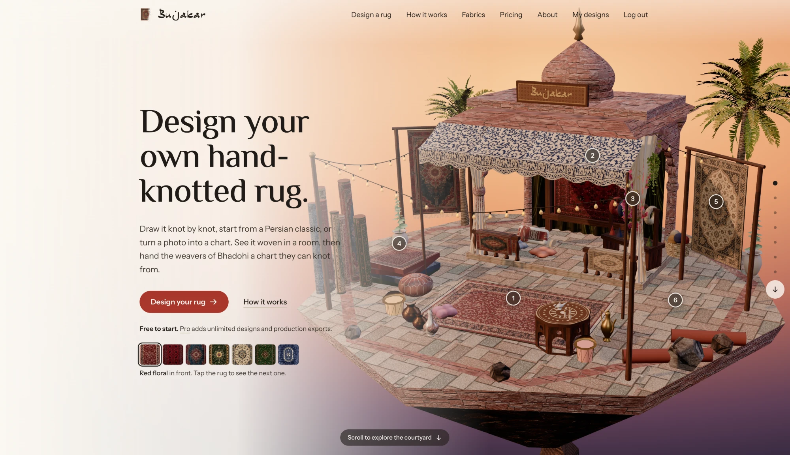
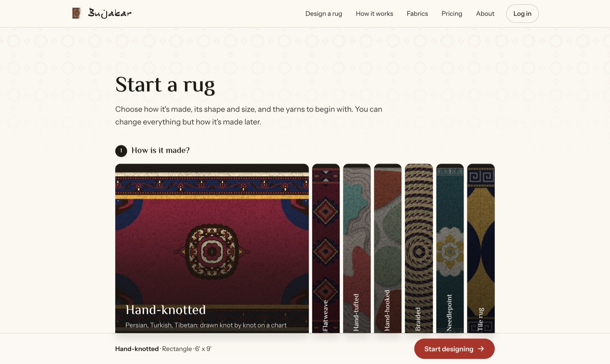
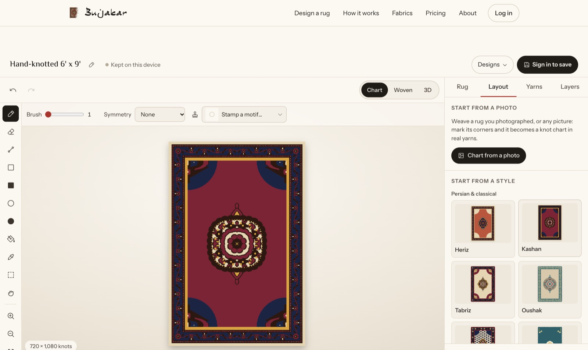
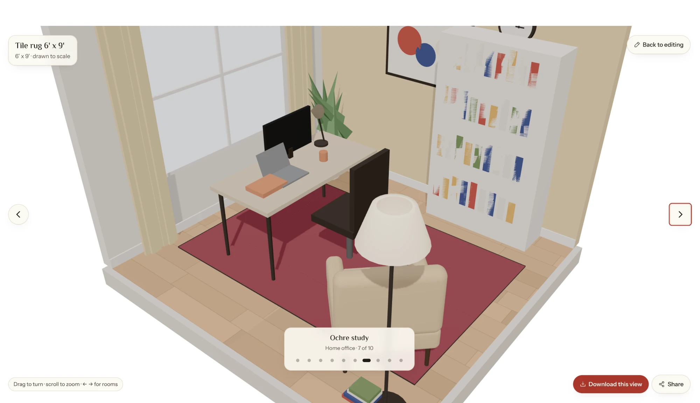
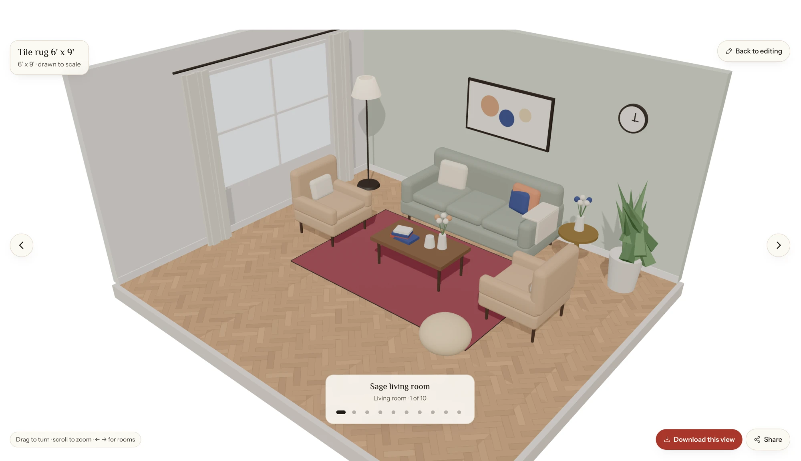
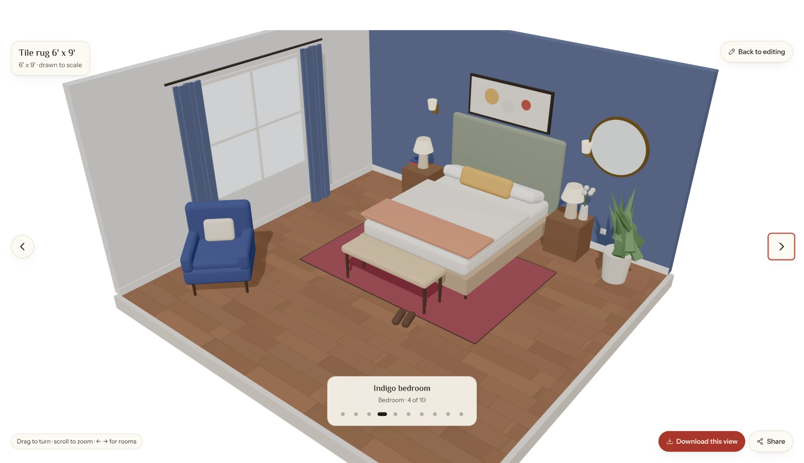

# Buनakar: design your own handwoven rug



**Live:** [bunakar.vercel.app](https://bunakar.vercel.app)

*Bunakar* is the Hindi word for weaver. It's a rug design studio from Mirzapur, in the carpet belt of
Uttar Pradesh, where Mirzapur and Bhadohi have knotted carpets for centuries. You design a rug the way
weavers read one, see it as real wool and in a room at its true size, and hand any workshop a chart it
can make.

**Stack:** React 19, TypeScript, Vite, Tailwind CSS 4, three.js (React Three Fiber) · NestJS 11,
TypeORM, PostgreSQL · JWT auth · Playwright · GitHub Actions · Vercel (site), Render (API), Neon (database)

---

## What you can do

### Design any kind of rug, in one Studio



Start by choosing how the rug is made. Each kind opens the Studio with the right tools:

| Kind | How you design it |
|---|---|
| **Hand-knotted** | On a knot chart, the way weavers work: every square is one knot, at 40 to 225 knots a square inch |
| **Flatweave** (kilim, soumak, dhurrie) | On a chart in weft rows; long kilim slits are found and can be stepped for you |
| **Hand-tufted** and **hand-hooked** | Drawn freehand: shapes in any outline, each with its own pile (cut, loop, high-low, shag) and carved lines |
| **Braided** | Coiled bands of three-strand braid, in rounds and ovals, each band in yarns you choose |
| **Needlepoint** | A fine stitch chart, for Aubusson and Bessarabian styles |
| **Tile rug** | Modular 18-inch tiles in ten cuts, with medallions and borders on top |

Then pick a shape (rectangle, runner, round, oval or octagon) drawn to scale on a one-foot grid, a size
up to 60 feet, how fine it is, and the yarns to begin with. Every starting palette is previewed on the
kind of rug you chose.

### Draw it, or start from a classic or a photo



- **Knot chart editor:** pencil, line, rectangle, ellipse, fill, eyedropper, select, copy and paste;
  zoom, pan and undo/redo; full keyboard control.
- **Symmetry:** mirror across, down or in quarters (design a quarter, see the whole), or 4- and 8-way for
  round rugs and medallions.
- **Layouts as settings, not painting:** border bands and corner styles, field patterns (stripes,
  chevrons, diamonds, ikat), repeats, compartments, a prayer niche, a medallion with pendants, corner
  spandrels. Borders follow the rug's shape, so a round rug gets round borders.
- **Twenty classic styles:** Heriz, Kashan, Tabriz, Oushak, Isfahan, Baluch, Bukhara, Art Deco, a garden
  carpet, a prayer rug, Mamluk, Kazak, Gabbeh, kilims, a Navajo eye-dazzler, ikat and more, each a whole
  layout in its own yarns.
- **Motif stamps** from a catalogue of medallions, borders and motifs, drawn in the rug's own yarns.
- **Photo to chart:** upload a photo, mark its four corners to straighten it, choose 4 to 32 yarns, and
  it becomes an editable knot chart in real catalogue yarns (colour reduction in OKLab, in a Web Worker).

### See it as real wool, in 3D, and in a room

| | |
|---|---|
|  |  |
|  | Every design can be seen **woven**: pile, light, abrash, wash, fringe, binding or kilim ends. It can be turned **in 3D**, and walked into **ten rooms** (living rooms, bedrooms, a dining room, hallways, a study, a reading corner and a hotel lobby), each built around the rug at its real size. Download the view or share a link. |

### Hand it to the weaver

- **Weaver's chart** (Pro): a printable chart paged so each sheet is easy to work from, with numbered rows
  and columns, a symbol and code for every yarn, knot counts and estimated yarn weights. A
  quarter-symmetric rug can be printed as one quarter.
- **Tufting template** (Pro): every shape outlined full size and labelled, with a yarn legend.
- **Tile map** (Pro): each tile labelled with its colour code and cut, and a wool list.
- Bunakar doesn't sell rugs. Designs are yours, to make with any weaver you choose.

### And around it

- **The home page** is a 3D courtyard you scroll through (with a 2D version for devices without WebGL),
  opening once a session with "weaver" in Hindi, Urdu and English.
- **Fabrics:** wool, silk, cotton, jute and more, each close up in 3D.
- **Accounts:** design as a guest (kept in the browser), sign in to save, share read-only links. Free keeps
  5 designs; Pro is unlimited.
- **Pages:** About, Pricing, a card-index FAQ, Contact, Credits and the legal pages.

## How it works

**One rug document.** Every design, of every kind, is one `RugDoc`
([`frontend/src/studio/model.ts`](frontend/src/studio/model.ts)): construction, shape, size, density,
a palette of catalogue yarns, a layout, and layers (knot charts, freehand shapes, placed motifs, tiles),
plus finishes. Charts are stored compressed. Designs from the earlier tile and freeform designers are
converted to it when they open.

**One composer, every view.** The layers are flattened into one indexed picture and a relief map. The chart
editor, the woven render, the 3D rug, the room scenes, thumbnails and exports all draw from that, so they
can't drift apart.

**Rules from the craft.** Kilim slits are checked against a maximum length, braids are generated band by
band from the outline inward, and the weaver's chart is paged and numbered the way charts are read on the
loom (rows from the bottom).

**The API** stores accounts and designs. Each design is checked against its owner on every request, input is
validated with size limits, the Free plan's limit is enforced on the server, and a shared link opens a
read-only copy that never exposes the owner. The database schema comes from TypeORM migrations, run when the
API starts.

## Project structure

```
frontend/src/
  studio/            the rug document, layouts, symmetry, weave rules, photo to chart, weaver's chart
  components/studio/ the Studio: setup, chart editor, panels
  three/             the courtyard, rooms, the woven rug in 3D, fabrics
  pages/             Home, Studio, Room preview, My Designs, Fabrics, About, Pricing, FAQ, ...
  components/        home/, freeform/, tileDesigner/, content/, common/, ui/
  data/              yarns, motifs, styles, rooms, FAQ
backend/src/
  auth/              register, login, JWT, login rate limit
  rug-designs/       Studio designs: CRUD and read-only share links
  tile-designs/      earlier tile designs (kept, convert on open)
  freeform-designs/  earlier freeform designs (kept, convert on open)
  swatches/          the yarn catalogue, seeded on start
  inbox/             contact messages and the Pro list
  migrations/        the database schema
```

The API is documented in [docs/api.md](docs/api.md) and the database in [docs/schema.md](docs/schema.md).

## Run it locally

**With Docker:**

```bash
cp .env.example .env    # then set POSTGRES_PASSWORD and JWT_SECRET
docker compose up --build
```

The site runs at http://localhost:5173 and the API at http://localhost:3000.

**Without Docker** (needs Node 20.19+ and PostgreSQL):

```bash
cd backend  && cp .env.example .env && npm install && npm run start:dev
cd frontend && cp .env.example .env && npm install && npm run dev
```

**Checks:**

```bash
cd backend  && npm run lint && npm test && npm run build
cd frontend && npm run lint && npm run check && npm run build   # check runs every *.check.ts self-check
cd frontend && npx playwright test                              # browser tests: desktop, tablet, phone, no WebGL, reduced motion
```

## Deploy

| Service | Settings |
|---|---|
| **API** on Render (**New → Blueprint** reads [`render.yaml`](render.yaml)) | `DATABASE_URL` (with `?sslmode=require`), `JWT_SECRET`, `NODE_ENV=production`, `CORS_ORIGIN=<site URL>`. Migrations run when it starts. |
| **Site** on Vercel, root `frontend` | `VITE_API_URL=<API URL>`. Security headers and routing come from [`vercel.json`](frontend/vercel.json). |
| **Database** (e.g. Neon) | PostgreSQL 14+ |

## Credits

The courtyard's 3D models are by 00amza, cha, Vinnie D'Cruz and rhcreations, under CC BY 4.0; see the
[credits page](https://bunakar.vercel.app/credits) and [`frontend/assets-src/LICENSES.md`](frontend/assets-src/LICENSES.md).
Fonts: El Messiri and Instrument Sans (SIL Open Font License).

Built by [Talmeez Akhtar](https://talmeezakhtar.github.io/).
